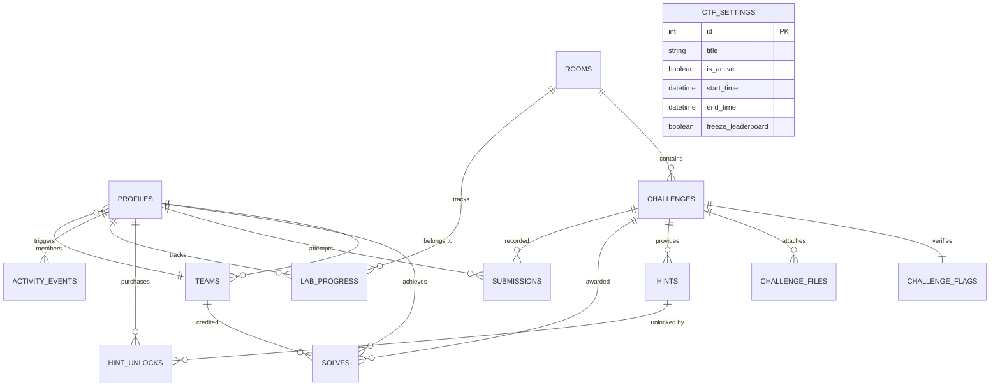

# CTF Arena - Enterprise Cybersecurity Competition Platform

CTF Arena is a production-ready, TryHackMe-style Capture The Flag (CTF) cyber defense training platform. Competitors and squads solve hands-on cybersecurity labs, submit cryptographically verified flags, and compete on a live scoreboard. Administrators possess an advanced operations center featuring real-time competitor tracking, automated anomaly heuristics, lab cohort telemetry, and a two-dimensional solve matrix heatmap.

---

## Table of Contents

1. [Architecture Overview & Data Flow](#1-architecture-overview--data-flow)
2. [Technology Stack Rationale](#2-technology-stack-rationale)
3. [Repository Structure](#3-repository-structure)
4. [Comprehensive Page Directory](#4-comprehensive-page-directory)
5. [Administrative Monitoring & Operations Guide](#5-administrative-monitoring--operations-guide)
6. [API Reference Specification](#6-api-reference-specification)
7. [Database Schema & Entity Relationship Diagram](#7-database-schema--entity-relationship-diagram)
8. [Row-Level Security (RLS) Model](#8-row-level-security-rls-model)
9. [Complete Supabase Step-by-Step Setup Guide](#9-complete-supabase-step-by-step-setup-guide)
10. [Local Development Quickstart](#10-local-development-quickstart)
11. [Adding Labs, Challenges, and Generating Flag Hashes](#11-adding-labs-challenges-and-generating-flag-hashes)
12. [Scoring System & Tie-Break Rules](#12-scoring-system--tie-break-rules)
13. [End-to-End Demo Walkthrough](#13-end-to-end-demo-walkthrough)
14. [Security Invariants & Known Constraints](#14-security-invariants--known-constraints)

---

## 1. Architecture Overview & Data Flow

CTF Arena strictly decouples static presentation, client authentication, and platform game logic:

```
+-------------------------------------------------------------------------+
|                              USER BROWSER                               |
|        (Vanilla HTML5, Hand-Written CSS, Native ES2022 JavaScript)      |
+--------------------+--------------------------------+-------------------+
                     | (1) Sign in / Auth Session     | (3) Bearer JWT +
                     |                                |     Game Requests
                     v                                v
       +----------------------------+   +---------------------------------+
       |       SUPABASE AUTH        |   |         FASTAPI BACKEND         |
       |  (Issues Bearer JWT via    |   |  (Python 3.11+, SlowAPI limits, |
       |   HS256 signed secret)     |   |   Pydantic v2, PyJWT auth)      |
       +----------------------------+   +----------------+----------------+
                                                         | (4) service_role
                                                         |     (Bypasses RLS)
                                                         v
                                        +---------------------------------+
                                        |       SUPABASE POSTGRESQL       |
                                        | (13 Tables, RLS Deny-By-Default,|
                                        |  Analytical SQL Views, Triggers)|
                                        +---------------------------------+
```

### Flag Submission Data Flow

```
[Browser Form]
      |
      | 1. POST /challenges/{id}/submit with {"flag": "CTF{flag_val}"} + Bearer JWT
      v
[FastAPI Backend - app/routers/challenges.py]
      |
      | 2. Rate limiter checks (SlowAPI: 10 attempts/minute per IP/User)
      | 3. PyJWT validates Bearer token against SUPABASE_JWT_SECRET
      | 4. Security checks: User not banned, CTF within active start/end window
      | 5. Duplicate check: Ensures user and team have not previously solved
      | 6. Cryptographic verification:
      |    compute_flag_hash(plain_flag, salt) == challenge_flags.flag_hash
      |    (Evaluated in constant-time via hmac.compare_digest)
      |
      +-----> If Incorrect:
      |         - Inserts row into submissions (is_correct=false)
      |         - Inserts activity_events (flag_attempt_wrong)
      |         - Returns {"is_correct": false, "message": "Incorrect flag"}
      |
      +-----> If Correct:
                - Inserts row into submissions (is_correct=true)
                - Atomically inserts row into solves (enforces unique challenge/user constraint)
                - Checks if solve is first blood across the entire platform
                - Inserts activity_events (flag_solved)
                - Updates user profile points atomically
                - Evaluates lab progress: if user solved all published challenges in lab,
                  updates lab_progress.status = 'completed' and triggers lab_completed event
                - Returns FlagSubmitResponse with points, first blood, and completion status
```

---

## 2. Technology Stack Rationale

### Frontend: Plain HTML5, Vanilla CSS, and Native ES Modules
- **Zero Build Step**: Eliminates complex bundlers (Webpack, Vite, Rollup), node_modules bloat, and compilation steps. Directly hosted on any edge static provider.
- **Security**: Vanilla JavaScript with an explicit `escapeHtml()` helper and `DOMPurify` prevents Cross-Site Scripting (XSS).
- **Hacker Terminal Aesthetic**: Hand-crafted CSS using custom properties (`--bg-primary`, `--accent-green`, `--accent-cyan`), dark glassmorphism surfaces, and monospace data typography.
- **Zero Emoji Compliance**: Plain ASCII badges and inline hand-drawn SVG icons exclusively.

### Backend: Python 3.11+ FastAPI
- **Performance & Async IO**: High throughput asynchronous endpoints powered by Starlette and Uvicorn.
- **Strict Data Contracts**: Pydantic v2 schemas guarantee zero sensitive internal data leakage (salted flag hashes and internal salts are never returned in responses).
- **SlowAPI Rate Limiting**: Guards challenge flag submission and authentication endpoints against automated brute-force attacks.

### Database: Supabase PostgreSQL
- **Defense in Depth**: RLS policies are enabled on all 13 tables with deny-by-default for anonymous and authenticated clients. All platform business logic is brokered by the FastAPI backend using the server-side `service_role` key.
- **Analytical Views**: Database-level aggregation views (`admin_user_summary`, `admin_lab_stats`, `admin_live_activity`, `user_leaderboard`) avoid N+1 query bottlenecks.

---

## 3. Repository Structure

```
ctf-arena/
  README.md                     # Comprehensive platform master documentation
  DEPLOYMENT.md                 # Cloud hosting guide for Render, Railway, Fly.io, Cloudflare
  backend/
    .env.example                # Backend configuration template
    requirements.txt            # Python dependencies (FastAPI, Uvicorn, Pydantic, PyJWT, SlowAPI)
    Dockerfile                  # Production container definition
    app/
      main.py                   # FastAPI application initialization and router mounting
      core/
        config.py               # Pydantic BaseSettings runtime environment configuration
        security.py             # JWT signature verification and constant-time flag hashing
        deps.py                 # FastAPI dependency injection (get_current_user, require_admin)
        rate_limit.py           # SlowAPI rate limiting engine
      db/
        client.py               # Supabase service_role authenticated client factory
      models/
        common.py               # Common response schemas (Health, CTF Status)
        user.py                 # User profile schemas
        team.py                 # Squad collaboration schemas
        room.py                 # Lab / Room schemas
        challenge.py            # Challenge, hint, and submission schemas
        leaderboard.py          # Scoreboard and timeline schemas
        dashboard.py            # Competitor dashboard aggregator schema
        admin.py                # Administrative content management schemas
        monitor.py              # Telemetry, cohort, matrix heatmap, and alert schemas
      routers/
        auth.py                 # Profile lifecycle and heartbeat endpoints
        teams.py                # Squad creation, join codes, and captain management
        rooms.py                # Lab exploration endpoints
        challenges.py           # Challenge inspection, file downloads, and flag submit
        hints.py                # Hint unlocking and point cost penalties
        leaderboard.py          # Public scoreboard and score-over-time timeline
        dashboard.py            # User summary dashboard aggregator
        admin.py                # Administrative CRUD for labs, challenges, users, settings
        admin_monitor.py        # Operations telemetry, live feeds, matrix, and CSV exports
      services/
        flag_service.py         # Flag evaluation, first blood, and lab completion triggers
        alert_service.py        # Automated heuristics for stuck users and brute-force spikes
        monitor_service.py      # Telemetry aggregation, cohorts, heatmap, and CSV streaming
    tests/
      test_flag_verification.py # Flag verification and first-blood test cases
      test_admin_monitor.py     # CSV formula sanitization and matrix streaming test cases
      test_security_edge_cases.py # JWT validation, time locks, status reversion tests
  frontend/
    index.html                  # Landing page for guests and authenticated dashboard at root
    login.html                  # Username/password login
    dashboard.html              # Competitor personal command center
    labs.html                   # Lab training catalog
    lab.html                    # Lab room view with challenge listing
    challenge.html              # Interactive terminal challenge page with flag submission
    leaderboard.html            # Public individual and squad scoreboards with Chart.js
    team.html                   # Squad management center (create, join, kick, invite code)
    team-profile.html           # Public squad profile and solve history
    profile.html                # Public competitor profile and badge showcase
    settings.html               # Account profile editor
    404.html                    # Target not found error page
    admin/
      index.html                # Mission Operations Hub navigation
      monitor.html              # Real-time telemetry, completion charts, and alerts
      live.html                 # Live activity stream with 10s auto-polling
      progress.html             # Competitor progress directory with CSV export
      user.html                 # Individual competitor audit deep dive
      lab.html                  # Lab cohort breakdown (Completed, In Progress, Not Started)
      matrix.html               # Two-dimensional solve matrix heatmap
      labs.html                 # Lab authoring and publishing manager
      challenges.html           # Challenge authoring and salted flag manager
      users.html                # Competitor account oversight and ban/unban controls
      teams.html                # Squad management and score reset tools
      submissions.html          # Global submission audit log
      settings.html             # CTF competition start/end scheduling
    css/
      variables.css             # Color palette tokens, typography, and spacing
      base.css                  # Modern reset, typography styles, and scrollbars
      layout.css                # Grid containers, headers, and footers
      components.css            # Buttons, cards, badges, forms, modals, toasts, progress bars
      admin.css                 # Admin tables, stat cards, matrix heatmap, and alert styles
    js/
      config.example.js         # Frontend runtime config template
      config.js                 # Local frontend configuration (git-ignored)
      supabaseClient.js         # Supabase client initialized for Auth operations only
      api.js                    # Authenticated fetch wrapper handling Bearer JWT injection
      auth.js                   # Client auth state management and route guards
      ui.js                     # Toasts, confirmation modals, and skeleton loaders
      icons.js                  # Clean inline SVG icon definitions (Zero emoji)
      utils.js                  # Time formatting, score calculations, and HTML escaping
      layout.js                 # Shared header navigation, admin subnav, and footer
      pages/                    # Page-specific frontend controllers
      admin/                    # Administrative frontend controllers
    assets/
      logo.svg                  # Vector brand identity
      favicon.svg               # Vector brand favicon
  supabase/
    schema.sql                  # PostgreSQL schema (13 tables, constraints, foreign keys)
    policies.sql                # Row-Level Security policies (Deny-by-default)
    views.sql                   # Analytical views and monitoring queries
    seed.sql                    # Initial seed data with demo labs, challenges, and teams
```

---

## 4. Comprehensive Page Directory

| Page Path | Access Level | Purpose | Key Data Read | Actions Performed | Endpoints Invoked |
| :--- | :--- | :--- | :--- | :--- | :--- |
| `index.html` | Public / Competitor | Public landing page or signed-in dashboard | CTF status and top teams for guests; profile, score, progress and activity for signed-in users | Browse labs or review dashboard | `GET /ctf/status`, `GET /leaderboard/teams`, `GET /dashboard` |
| `login.html` | Public | Authenticate into platform | Username and password | Log in with credentials issued by an administrator | `POST /auth/login` then Supabase session establishment |
| `dashboard.html` | Competitor legacy route | Redirects to the root dashboard | None | Redirect to `/` | None |
| `labs.html` | Public / Competitor | Catalog of cybersecurity training rooms | Published labs, difficulties, tags | Filter by difficulty and search labs | `GET /rooms` |
| `lab.html?slug=` | Competitor | Individual lab briefing and challenges | Lab briefing, published challenges, solve status | Navigate to specific challenge targets | `GET /rooms/{slug}` |
| `challenge.html?id=` | Competitor | Challenge terminal & flag submission | Description, attachments, unlocked hints | Submit flag, unlock hints, download files | `GET /challenges/{id}`, `POST /challenges/{id}/submit`, `POST /hints/{id}/unlock`, `GET /challenges/{id}/files/{file_id}` |
| `leaderboard.html` | Public | Live scoreboard and timeline | Individual/squad ranks, score timeline | Filter scores, inspect score chart, auto-poll (15s) | `GET /leaderboard/users`, `GET /leaderboard/teams`, `GET /leaderboard/timeline` |
| `team.html` | Competitor | Squad management hub | Current squad members, secret invite code | Create squad, join by code, leave, kick members | `GET /teams/me`, `POST /teams`, `POST /teams/join`, `POST /teams/leave`, `POST /teams/{id}/regenerate-invite`, `DELETE /teams/{id}/members/{user_id}` |
| `team-profile.html?id=` | Public | Public squad showcase | Squad roster, score, solve timeline | Inspect squad solve history | `GET /teams/{id}` |
| `profile.html?username=` | Public | Public competitor profile | Display name, score, rank, solve records | Inspect competitor activity | `GET /users/{username}` |
| `settings.html` | Competitor | Account settings | Profile details | Update display name, avatar, or password without the old password | `GET /me`, `PATCH /me`, `POST /me/password` |
| `404.html` | Public | Target not found fallback | None | Return to arena or lobby | None |
| `admin/index.html` | Admin | Mission Operations Hub navigation | Overview metrics preview | Navigate administrative tools | `GET /admin/monitor/overview` |
| `admin/monitor.html` | Admin | Operations Telemetry Center | Active online counts, completion rates, failure rates | Inspect live charts, review heuristic alerts | `GET /admin/monitor/overview`, `GET /admin/monitor/alerts` |
| `admin/live.html` | Admin | Real-time live activity stream | Active online users, live security events | Filter events by type, 10s auto-polling | `GET /admin/monitor/live`, `GET /admin/monitor/events` |
| `admin/progress.html` | Admin | Competitor progress directory | All competitors, completed labs, points | Search, filter, inspect user, export CSV | `GET /admin/monitor/users`, `GET /admin/monitor/export/users.csv` |
| `admin/user.html?id=` | Admin | Competitor audit deep dive | Lab cards, challenge breakdown, timeline | Inspect challenge attempts, hint deductions | `GET /admin/monitor/users/{user_id}` |
| `admin/lab.html?id=` | Admin | Lab cohort telemetry | Completed, In Progress, Not Started cohorts | Inspect hardest challenges, analyze funnel | `GET /admin/monitor/labs/{room_id}` |
| `admin/matrix.html` | Admin | Progress matrix heatmap | Competitors/squads by labs heatmap | Toggle users/teams, inspect solve status, export CSV | `GET /admin/monitor/matrix`, `GET /admin/monitor/export/matrix.csv` |
| `admin/labs.html` | Admin | Lab content management | All labs (published & drafts) | Create, edit, publish/unpublish, delete labs | `GET /admin/rooms`, `POST /admin/rooms`, `PATCH /admin/rooms/{id}`, `DELETE /admin/rooms/{id}` |
| `admin/challenges.html` | Admin | Challenge authoring & flag manager | All challenges, flags (salted SHA-256) | Create challenge, update salted flags, add hints | `GET /admin/challenges`, `POST /admin/challenges`, `PATCH /admin/challenges/{id}`, `DELETE /admin/challenges/{id}` |
| `admin/users.html` | Admin | Competitor oversight | Registered competitors, roles, ban status and team | Create username/password accounts, assign team, reset password, suspend or delete users | `GET /admin/users`, `POST /admin/users`, `POST /admin/users/{id}/ban` |
| `admin/teams.html` | Admin | Squad management & integrity | Teams and current members | Create teams, add/remove members, reset scores, disband teams | `GET /admin/teams`, `POST /admin/teams/{id}/members`, `DELETE /admin/teams/{id}/members/{user_id}`, `DELETE /admin/teams/{id}`, `POST /admin/teams/{id}/reset-score` |
| `admin/submissions.html`| Admin | Global flag submission audit log | All submission attempts, results, flags | Audit raw flag submissions and timestamps | `GET /admin/submissions` |
| `admin/settings.html` | Admin | Competition schedule & settings | CTF start/end time, active status | Control submission freeze, update dates | `GET /admin/settings`, `PATCH /admin/settings` |

---

## 5. Administrative Monitoring & Operations Guide

### Overview Dashboard (`admin/monitor.html`)
- **Registered Competitors**: Total user accounts enrolled in the platform.
- **Active Now**: Competitors who transmitted a `/me/heartbeat` ping within `ACTIVE_WINDOW_MINUTES` (default 5 minutes).
- **Engaged in Lab**: Active competitors currently viewing or submitting flags within a specific room (`current_room_id` is set).
- **Completed Today**: Competitors who solved 100% of published challenges in a lab within the current UTC calendar day.
- **Platform Avg Completion**: Mean percentage of published labs completed across all competitors.
- **Total Submissions & Failure Rate**: Total flag submissions processed and the percentage evaluated as incorrect.
- **Status Distribution Chart**: Chart.js doughnut chart breaking down competitor states: `Not Started` (grey), `In Progress` (amber), `Completed` (green).
- **Completions Timeline**: 7-day line chart tracking daily completed labs.
- **Completion Rate by Lab**: Horizontal bar chart comparing completion percentages across rooms.

### Live Activity Stream (`admin/live.html`)
- **Online Competitors Table**: Auto-polls every 10 seconds. Displays current lab, current challenge, last seen time, and last event for every competitor online.
- **Audit Event Feed**: Chronological log of security events (`flag_solved`, `flag_attempt_wrong`, `hint_unlocked`, `lab_completed`, `lab_opened`) with metadata (points awarded, hint penalties, attempt number).

### Competitor Progress Directory (`admin/progress.html`)

### Competitor Audit Deep Dive (`admin/user.html?id=`)

### Lab Cohort Telemetry (`admin/lab.html?id=`)
- `POST /me/password`: Set the current user's new password without requiring their old password; requires a valid login session.
- Two-dimensional grid with competitors or squads on the Y-axis and published labs on the X-axis.
- Sticky left column and sticky headers for seamless horizontal navigation across large catalogs.
- Color-coded cells:
  - **Grey (`not_started`)**: 0% solved.
  - **Amber (`in_progress`)**: 1% to 99% solved.
  - **Green (`completed`)**: 100% solved.
- Hover tooltips provide exact solve ratios and points earned.
- **Export Matrix CSV**: Streams a sanitized CSV representation of the matrix.

### Automated Heuristics & Alerts Panel
1. **Stuck Competitors**: Triggered when a competitor has been active in a lab for longer than `STUCK_THRESHOLD_MINUTES` (default 20 minutes) with 3 or more wrong flag attempts and 0 solves.
2. **Inactive Registrants**: Accounts registered over 48 hours ago that have never opened a lab or attempted a flag.
3. **Suspicious Submission Bursts**: Triggered when a competitor submits 5 or more incorrect flags within a 60-second window, signaling automated brute-force scripts.

---

## 6. API Reference Specification

All protected endpoints require an `Authorization: Bearer <JWT>` header containing a valid Supabase authentication token.

### Public & System Endpoints
- `GET /health`: Health probe. Returns service status, version, and Supabase connectivity.
- `GET /ctf/status`: Returns competition active flag, start time, end time, and remaining seconds.

### Profile & Authentication Endpoints
- `GET /me`: Returns profile of the authenticated competitor.
- `PATCH /me`: Updates display name, bio, or avatar URL.
- `POST /me/heartbeat`: Competitor heartbeat. Updates `last_seen_at`, `current_room_id`, and `current_challenge_id`. (Rate limited: 60/min).
- `GET /users/{username}`: Returns public profile, rank, points, and solve history for a competitor.

### Squad / Team Endpoints
- `POST /teams`: Creates a new squad with unique name. Returns squad profile and captain invite code.
- `POST /teams/join`: Joins an existing squad using an invite code.
- `POST /teams/leave`: Leaves the current squad. If captain leaves, disbands or reassigns.
- `GET /teams/me`: Returns detailed squad data, roster, and private invite code for members.
- `GET /teams/{id}`: Returns public squad details, members, and solve records.
- `PATCH /teams/{id}`: Updates squad name (Captain only).
- `POST /teams/{id}/regenerate-invite`: Generates a new secret invite code (Captain only).
- `DELETE /teams/{id}/members/{user_id}`: Kicks a member from the squad (Captain only).
- `DELETE /teams/{id}`: Disbands the squad (Captain only).

### Lab & Challenge Endpoints
- `GET /rooms`: Returns all published labs with challenge counts and points.
- `GET /rooms/{slug}`: Returns lab briefing and list of published challenges.
- `GET /challenges/{id}`: Returns challenge Markdown description, attachments, unlocked hints, and solve state.
- `POST /challenges/{id}/submit`: Submits flag string. Evaluates salted hash, awards points and first blood, updates lab progress. (Rate limited: 10/min).
- `POST /hints/{id}/unlock`: Deducts hint cost and unlocks hint content.
- `GET /challenges/{id}/files/{file_id}`: Issues signed, time-limited download URL for private challenge files.

### Leaderboard & Dashboard Endpoints
- `GET /leaderboard/users`: Paginated individual leaderboard sorted by points, solves, and earliest solve timestamp.
- `GET /leaderboard/teams`: Paginated squad leaderboard sorted by points, solves, and earliest solve timestamp.
- `GET /leaderboard/timeline`: Score progression over time for top 10 squads (powers Chart.js timeline).
- `GET /dashboard`: Aggregated competitor command center data (stats, active lab, recent solves).

### Administrative Management Endpoints (`require_admin`)
- `GET /admin/rooms`: List all labs including drafts.
- `POST /admin/rooms`: Create a new lab.
- `PATCH /admin/rooms/{id}`: Update lab metadata or published state.
- `DELETE /admin/rooms/{id}`: Delete lab and associated challenges.
- `GET /admin/challenges`: List all challenges.
- `POST /admin/challenges`: Create challenge and generate salted SHA-256 flag hash.
- `PATCH /admin/challenges/{id}`: Update challenge details or reset flag hash.
- `DELETE /admin/challenges/{id}`: Delete challenge.
- `POST /admin/challenges/{id}/hints`: Add hint with point penalty cost.
- `DELETE /admin/hints/{id}`: Delete hint.
- `GET /admin/users`: List all competitor accounts.
- `POST /admin/users/{id}/ban`: Ban competitor account.
- `POST /admin/users/{id}/unban`: Restore competitor account.
- `GET /admin/teams`: List all squads.
- `DELETE /admin/teams/{id}`: Disband squad.
- `POST /admin/teams/{id}/reset-score`: Reset squad score to zero.
- `GET /admin/submissions`: Global raw flag submission audit log.
- `GET /admin/settings`: View competition start/end schedule.
- `PATCH /admin/settings`: Update competition start/end schedule and freeze status.

### Administrative Monitoring Endpoints (`require_admin`)
- `GET /admin/monitor/overview`: Telemetry stats, completion distributions, and charts.
- `GET /admin/monitor/live`: Active online competitors within active window.
- `GET /admin/monitor/events`: Chronological security event audit stream.
- `GET /admin/monitor/users`: Paginated competitor progress directory with search and filters.
- `GET /admin/monitor/users/{user_id}`: Individual competitor audit deep dive.
- `GET /admin/monitor/labs/{room_id}`: Lab cohort breakdown and difficulty metrics.
- `GET /admin/monitor/matrix`: Two-dimensional solve matrix heatmap.
- `GET /admin/monitor/alerts`: Heuristic alerts for stuck competitors, inactive users, and brute-force spikes.
- `GET /admin/monitor/export/users.csv`: Streaming sanitized CSV export of competitor progress.
- `GET /admin/monitor/export/matrix.csv`: Streaming sanitized CSV export of the matrix heatmap.

---

## 7. Database Schema & Entity Relationship Diagram



### Table Definitions
1. `profiles`: Competitor identities linked to `auth.users(id)`. Stores username, display name, role (`user`/`admin`), squad affiliation, points, `last_seen_at`, `current_room_id`, and `current_challenge_id`.
2. `teams`: Squad entities storing name, secret invite code, captain ID, and max member capacity (default 4).
3. `rooms`: Lab training modules storing title, slug, description, difficulty (`easy`, `medium`, `hard`, `insane`), display order, and `is_published`.
4. `challenges`: Individual targets storing title, category (`Web`, `Crypto`, `Pwn`, `Reverse`, `Forensics`, `OSINT`, `Misc`), points, difficulty, and Markdown description.
5. `challenge_flags`: Salted SHA-256 flag hashes. Never exposed to clients or returned in API responses.
6. `challenge_files`: Attachment file metadata stored in private Supabase Storage buckets.
7. `hints`: Clues associated with challenges, each with a configured point deduction cost.
8. `hint_unlocks`: Audit records of hints purchased by competitors or squads.
9. `submissions`: Complete forensic audit log of all flag attempts, timestamps, and correctness.
10. `solves`: Unique successful flag captures. Enforces database uniqueness on `(challenge_id, user_id)` and records First Blood status.
11. `lab_progress`: Tracks completion funnel per competitor per lab: status (`not_started`, `in_progress`, `completed`), solve count, total count, points earned, start time, and completion time.
12. `activity_events`: High-frequency platform event stream powering the admin live feed.
13. `ctf_settings`: Singleton configuration row managing competition timing and active submission windows.

---

## 8. Row-Level Security (RLS) Model

Supabase RLS is configured as a defense-in-depth security barrier across all 13 tables in `supabase/policies.sql`:

1. **Deny-by-Default**: Anonymous and standard authenticated clients have no direct write permissions to game tables (`solves`, `submissions`, `lab_progress`, `activity_events`).
2. **Zero Plaintext Flag Access**: The `challenge_flags` table has no client policies; it cannot be selected, updated, or read by any client-side token.
3. **Backend Authority**: The FastAPI backend connects exclusively using the Supabase `service_role` key, which bypasses RLS on the server. The backend validates permissions, roles, competition schedules, and rate limits before executing database operations.

---

## 9. Complete Supabase Step-by-Step Setup Guide

Follow this guide to provision a fresh Supabase project for CTF Arena:

1. **Create Project**: Sign in to [Supabase](https://supabase.com) and click **New Project**. Choose your preferred geographic region and configure a database password.
2. **Retrieve API Credentials**: Navigate to **Project Settings > API**:
   - Copy **Project URL** and **anon public key** into `frontend/js/config.js`.
   - Copy **service_role secret** and **JWT Secret** (under JWT Settings) into `backend/.env`.
3. **Execute SQL Migrations**: Open the **SQL Editor** in the Supabase Dashboard and run the SQL scripts in order:
   - Run `supabase/schema.sql`
   - Run `supabase/policies.sql`
   - Run `supabase/views.sql`
   - Run `supabase/seed.sql`
4. **Configure Authentication**: Navigate to **Authentication > URL Configuration**:
   - Set **Site URL** to `http://localhost:3000` (or your production frontend URL).
   - Under **Redirect URLs**, add `http://localhost:3000/**`, `http://127.0.0.1:8000/**`, and production domains.
5. **Private Storage Bucket Setup**:
   - Navigate to **Storage** and click **New Bucket**.
  - Name the bucket `challenge-files` and ensure the **Public bucket** toggle is **OFF** (Private).
  - Do not add public read policies or configure a public URL. The FastAPI service uploads/downloads files using the service-role client; competitors receive only authenticated API downloads.
  - Admin challenge authoring accepts PNG/JPG/GIF/WebP images, plain text/Markdown, Python source, PDF, and ZIP files, up to 10 MiB per file. Executable binaries and HTML/SVG are rejected. Python scripts are stored and served as forced downloads (`application/octet-stream`) and are never imported, evaluated, spawned, or run by the backend.
6. **Create or reset the administrator account without knowing its old password**:
   - In Supabase, open **SQL Editor** and run this query, replacing the username and new password. It updates the Auth password hash directly; no previous password is needed.
     ```sql
     UPDATE auth.users AS au
     SET encrypted_password = crypt('replace-with-a-long-new-password', gen_salt('bf')),
         updated_at = NOW()
     FROM public.profiles AS p
     WHERE p.id = au.id
       AND p.username = 'admin';
     ```
   - Confirm the query reports one row. If it reports zero rows, look up the account in **Authentication > Users** and ensure the `profiles` row uses the same user ID. This reset changes the password hash but does not change the account role.
   - To promote an existing account, use `UPDATE public.profiles SET role = 'admin' WHERE username = 'your_username';`.
  - Log in at `/login` using the username and new password. Public registration and email recovery are disabled; administrators create accounts and set/reset passwords from the admin panel.
  - Supabase **Authentication > Sign In / Providers > Email** must have password sign-in enabled. Admin-created accounts require a valid email address for Supabase Auth and use username/password for sign-in. Disabling the Email provider makes Supabase reject password login.

---

## 10. Local Development Quickstart

### Prerequisites
- Python 3.11+
- Web browser (Chrome, Firefox, Safari, Edge)
- Supabase project (Free tier)

### 1. Backend Setup
```bash
# Navigate to backend directory
cd backend

# Create and activate Python virtual environment
python -m venv .venv
# On Windows:
.venv\Scripts\activate
# On Linux/macOS:
source .venv/bin/activate

# Install dependencies
pip install -r requirements.txt

# Configure environment
cp .env.example .env
# Edit .env with your SUPABASE_URL, SUPABASE_SERVICE_ROLE_KEY, and SUPABASE_JWT_SECRET

# Start FastAPI development server
uvicorn app.main:app --reload --host 127.0.0.1 --port 8000
```
Interactive Swagger documentation is available at `http://127.0.0.1:8000/docs`.

### 2. Frontend Setup
Because the frontend requires no build steps or bundlers, start any local HTTP server:
```bash
# Navigate to frontend directory
cd frontend

# Copy configuration
cp js/config.example.js js/config.js
# Edit js/config.js with your SUPABASE_URL and SUPABASE_ANON_KEY

# Start static file server (Python built-in)
python -m http.server 3000
```
Open `http://localhost:3000` in your web browser.

### 3. Running with Docker
To run the containerized backend:
```bash
cd backend
docker build -t ctf-arena-backend .
docker run -p 8000:8000 --env-file .env ctf-arena-backend
```

### 4. Running Automated Tests
```bash
pytest backend/tests/
```

---

## 11. Adding Labs, Challenges, and Generating Flag Hashes

### Generating a Flag Hash via Python
Flags are stored as salted SHA-256 hashes combined with a server pepper:
$$\text{hash} = \text{SHA-256}(\text{plain\_flag} + \text{salt} + \text{FLAG\_PEPPER})$$

Generate hashes using Python:
```python
import hashlib

flag = "CTF{web_injection_master}"
salt = "rnd_salt_12345"
pepper = "arena_demo_pepper"  # Must match FLAG_PEPPER in backend/.env

computed_hash = hashlib.sha256(f"{flag}{salt}{pepper}".encode("utf-8")).hexdigest()
print(f"Salt: {salt}")
print(f"Hash: {computed_hash}")
```

### Adding Labs and Challenges via Admin Panel
1. Navigate to `/admin/labs.html` and click **Create New Lab**.
2. Fill in the Title, Slug, Description, Difficulty, and click **Save Lab**.
3. Navigate to `/admin/challenges.html` and click **Create Challenge**.
4. Select the Lab, Category, Points, and enter the Plaintext Flag.
5. The backend automatically generates a cryptographic salt and computes the salted SHA-256 hash before saving. Plaintext flags are discarded immediately and never stored.

---

## 12. Scoring System & Tie-Break Rules

1. **Challenge Scoring**: Each challenge has a fixed point value (e.g., 100, 250, 500). Points are awarded upon the first valid flag submission.
2. **First Blood**: The first competitor across the entire platform to capture a challenge flag is designated "First Blood" and awarded platform recognition in event feeds.
3. **Hint Penalties**: Unlocking hints deducts the configured hint cost from the user's earned points.
4. **Squad Scoring**: A challenge solved by any member of a squad credits the squad's total score once. Duplicate solves by teammates award zero duplicate team points.
5. **Leaderboard Tie-Breaking**: Competitors or squads with identical point totals are ranked by earliest solve time: whoever reached the tied point total first takes the higher rank.
6. **Dynamic Status Reversion**: If a user completes 100% of a lab and an administrator subsequently publishes a new challenge to that lab, the user's progress dynamically reverts to `in_progress` until the new challenge is solved.

---

## 13. End-to-End Demo Walkthrough

1. **Landing & Countdown**: Visit `http://localhost:3000`. The competition countdown timer counts down to competition start or conclusion.
2. **Admin-provisioned accounts**: Public registration is disabled. An administrator creates a username and password in the admin users panel, then shares the credentials securely with the user.
3. **Squad Formation**: Visit `team.html`, create a squad called `CyberGuardians`, and copy your secret invite code to share with teammates.
4. **Explore Labs**: Navigate to `labs.html`, choose the **Web Application Exploitation** lab, and open the first challenge: **SQL Injection Fundamentals**.
5. **Flag Capture**: Enter the demo flag `CTF{sql_injection_bypass_success}` into the submission terminal. A CSS success banner confirms verification, points are awarded, and First Blood is logged.
6. **Live Scoreboard**: Open `leaderboard.html` to see your username and squad instantly appear at the top of the scoreboard.
7. **Admin Operations Center**: Sign in with your administrative account, navigate to `/admin/monitor.html`, and watch live telemetry cards update with real-time solve counts, live feeds, and matrix heatmap statuses.

---

## 14. Security Invariants & Known Constraints

- **Zero Plaintext Flag Storage**: Plaintext flags are never stored in the database or logged in application traces. Only salted SHA-256 hashes are persisted.
- **Timing Attack Resistance**: Flag verification uses `hmac.compare_digest` to prevent timing-based side-channel attacks.
- **CSV Formula Injection Mitigation**: All CSV exports stream cells through `sanitize_csv_cell()`, prefixing dangerous trigger characters (`=`, `+`, `-`, `@`, `\t`, `\r`) with a single quote to prevent code execution in spreadsheet applications.
- **Strict Role Enforcement**: User roles are verified from database records (`profiles.role`) using the server-side `service_role` key, preventing client token role-spoofing.
- **Zero Emoji Compliance**: Plain text labels and hand-written SVG icons with `aria-hidden="true"` are used exclusively across the platform.
